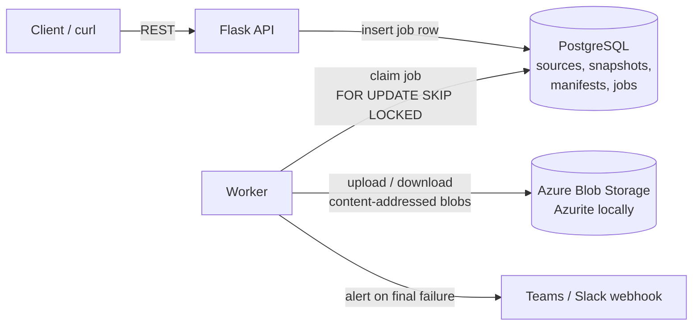

# Cloud Backup & Restore Service

A small, production-minded backup service in Python. It takes **incremental, deduplicated, checksum-verified snapshots** of a folder, stores them in **Azure Blob Storage**, and can **restore and verify** them later. Jobs run asynchronously through a worker with **retries, exponential backoff, dead-worker recovery and failure alerts**.

It is a miniature of what a data-protection platform does: *protect data, prove it can be recovered, and tell someone when it can't.*

**Stack:** Python 3.12 · Flask · SQLAlchemy · PostgreSQL · Azure Blob Storage (Azurite locally) · Docker Compose · GitHub Actions

---

## Architecture



**Why API and worker are separate processes:** backups can take minutes. The API only validates input and writes a job row (returns `202 Accepted`), so it stays fast. The worker does the heavy lifting and can be scaled to N copies without changing code.

### How a backup works (content-addressed storage)

1. Walk the source folder; for each file compute its **SHA-256**.
2. Blob name = `blobs/<first2>/<sha256>`. If that blob already exists, **skip the upload**.
3. Record the snapshot as a **manifest** in the DB: one row per file (`path → hash, size`).

Result: unchanged files are never re-uploaded (incremental), identical files are stored once (dedup), and a restore can be **verified** by re-hashing every file.

### Job lifecycle

```
queued ──claim──> running ──ok──> success
   ^                 │
   └── retry w/ backoff ◄── error (attempts < max)
                     └──────────► failed  (+ webhook alert)
```

## Features

| Area | What it does |
|---|---|
| Incremental backup | Only new or changed content is uploaded (`new_bytes` per snapshot shows it) |
| Verified restore | Every restored file is re-hashed; mismatch fails the job |
| Retention + GC | Keeps newest N snapshots; removes blobs nobody references |
| Reliability | Retries with exponential backoff, permanent vs. retryable errors, heartbeat + stale-job recovery |
| Scheduling | `schedule_minutes` per source; the worker enqueues due backups |
| Alerts | Webhook (Teams/Slack) when a job finally fails |
| Observability | JSON logs, `/health` (DB + storage), `/metrics` (job counts) |
| Security | Path-traversal protection (sources & restores confined to root dirs), non-root container |

## Quick start (Docker)

```bash
docker compose up --build        # Postgres + Azurite + API + worker
./scripts/demo.sh                # in another terminal: full walkthrough
```

Or by hand:

```bash
# register the sample folder (path is relative to SOURCE_ROOT=/data/source)
curl -X POST localhost:5000/sources -H 'Content-Type: application/json' \
     -d '{"name":"demo","path":".","retention_count":2}'

curl -X POST localhost:5000/sources/1/backup          # -> 202 + job
curl localhost:5000/jobs                              # watch queued -> running -> success
curl localhost:5000/sources/1/snapshots               # new_bytes = what was uploaded

curl -X POST localhost:5000/snapshots/1/restore \
     -H 'Content-Type: application/json' -d '{"target":"restore-1"}'
docker compose cp worker:/data/restores/restore-1 ./restored   # copy restored files out
```

To receive alerts, run with `WEBHOOK_URL=<your Teams/Slack incoming webhook> docker compose up`.

## Run without Docker

```bash
python -m venv .venv && source .venv/bin/activate
pip install -r requirements-dev.txt
cp .env.example .env            # SQLite + local-folder storage, no cloud needed
export $(grep -v '^#' .env | xargs)
python -m app.worker &          # worker
gunicorn -b 127.0.0.1:5000 app.wsgi:app
```

## Tests

```bash
pip install -r requirements-dev.txt
python -m pytest -q             # or: python -m unittest discover -s tests -t .
```

The tests use a local-folder storage backend and SQLite, so they need no Azure account and no Docker. They cover incremental behaviour, dedup, restore integrity (including tampered blobs and path traversal), retention/GC safety, retries/backoff/alerts, stale-job recovery, scheduling and the API.

## API

| Method | Path | Purpose |
|---|---|---|
| POST | `/sources` | Register a folder + policy (`name`, `path`, `retention_count`, `schedule_minutes`) |
| GET | `/sources` | List sources |
| POST | `/sources/<id>/backup` | Enqueue a backup (202) |
| GET | `/sources/<id>/snapshots` | List snapshots |
| POST | `/snapshots/<id>/restore` | Enqueue a verified restore (`target` folder name) |
| GET | `/jobs`, `/jobs/<id>` | Job status, attempts, error, result |
| GET | `/health` | DB + storage check (503 if degraded) |
| GET | `/metrics` | Plain-text job and snapshot counters |

## Project layout

```
app/
  api.py        Flask routes (validate, enqueue, return 202)
  worker.py     Poll loop, job execution, heartbeat, retry/alert handling
  jobs.py       Queue logic: enqueue, claim (SKIP LOCKED), backoff, stale recovery, scheduler
  backup.py     Core logic: hashing, backup, verified restore, retention, garbage collection
  storage.py    Storage interface + AzureBlobStorage + LocalStorage
  models.py     SQLAlchemy tables
  db.py         Engine/session helper
  config.py     Environment-based settings
  notifier.py   Webhook alerts
tests/          Unit + API tests
docs/EXPLAINER.md   Design walkthrough + interview prep
```

## Design decisions & known limitations

- **DB-backed queue instead of Redis/Kafka:** transactional with the data, one fewer service, easy to reason about. Cost: polling and limited throughput. Next step would be a broker.
- **Atomic snapshots:** the snapshot and its job's success commit in one transaction. A crash never leaves a half-made snapshot visible.
- **Metadata deleted before data:** a crash during retention leaves harmless orphan blobs, never snapshots pointing at missing data.
- **GC is skipped while a backup is running**, to avoid deleting blobs an uncommitted snapshot is about to reference. A check-then-act race remains; a grace period on blob age would close it.
- **Whole-file hashing:** a one-byte change re-uploads the whole file. Chunk-level dedup (as real products do) is the natural next step.
- **A file modified mid-backup** can hash differently from what is uploaded; verified restore would catch it. Real systems snapshot the filesystem first.
- SQLite is for tests only; use PostgreSQL for anything with concurrent workers.

## Roadmap ideas

Chunk-level dedup · client-side encryption (Azure Key Vault) · Kubernetes manifests (api Deployment, worker Deployment, CronJob) · Prometheus-format metrics · restore-to-Azure-Blob target.
